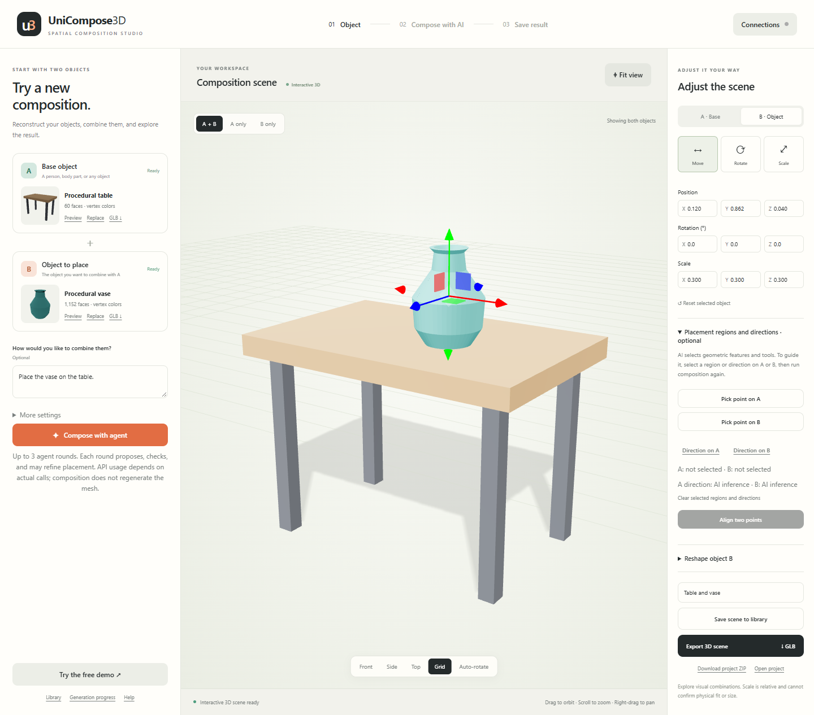
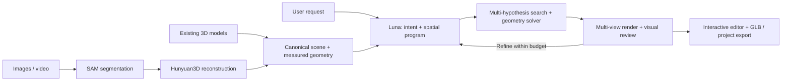
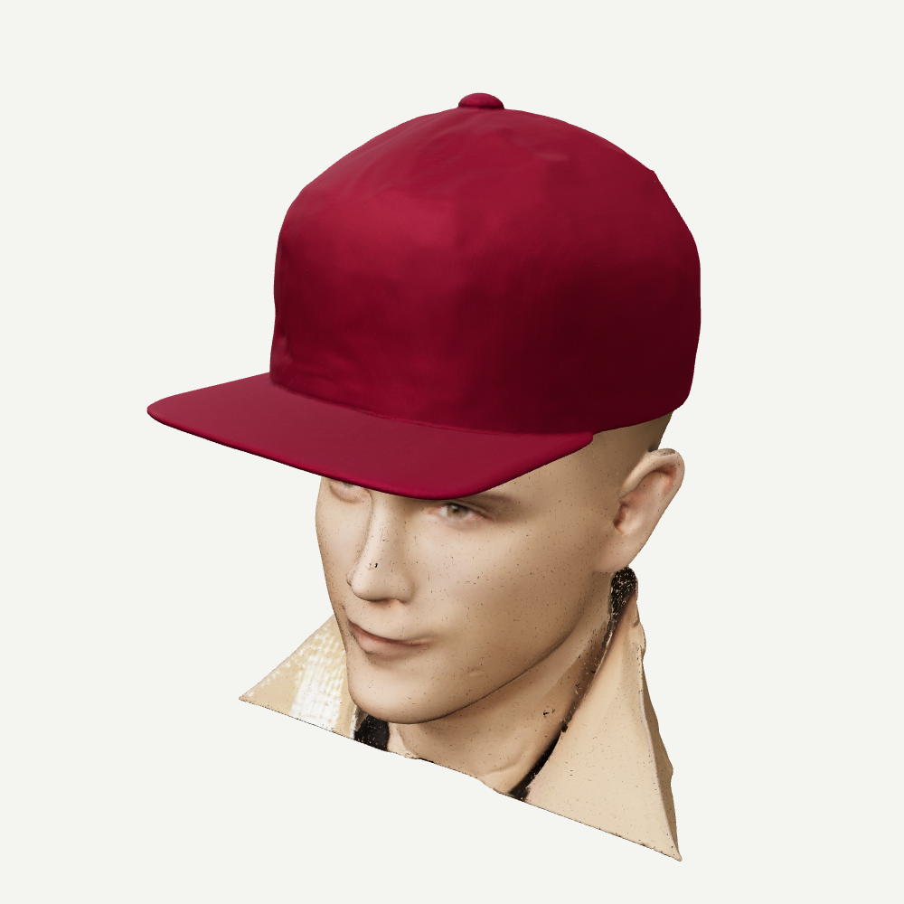

# UniCompose3D

**An Agentic Framework for Universal 3D Reconstruction and Intelligent Spatial Composition**

Turn images into editable 3D objects, then combine them with a short natural-language request. Built with Hunyuan3D, SAM, GPT-6 Luna, and a geometry-guided agent.



### What it does

- Import images, video frames, or existing 3D models.
- Isolate the intended object and reconstruct geometry with textures.
- Explore multiple placement hypotheses, optimize position, rotation, and relative scale, then review geometry and rendered views.
- Ask for clarification when intent is ambiguous; keep manual editing available.
- Inspect, rotate, replace objects, and export an interactive GLB scene or a reusable project ZIP.

### Pipeline



### Run

Python 3.11+ is required for the Studio. GPU reconstruction uses a separate model environment.

```bash
python -m pip install -e .
python tools/prepare_assets.py
cp .env.example .env
python launch.py
```

Set `OPENAI_API_KEY` in `.env` for AI composition. Open the complete session link printed by the launcher. The procedural demo and manual editor work without an API key; reconstruction requires the GPU setup.

**Kaggle T4:** follow [the setup guide](docs/kaggle.md) and import [the launcher notebook](notebooks/UniCompose3D_Kaggle.ipynb).

### Demonstrations



Actual rendered 3D geometry from a development replay; this image is not evidence of a new live API evaluation. See [demo notes](docs/assets/README.md).

### Development

```bash
python -m pip install -r requirements-dev.txt
python -m unittest discover -s tests
python tools/benchmark_composition.py --output test-results/composition.json
```

Read [architecture](docs/architecture.md) and [evaluation and limitations](docs/evaluation.md).

The pipeline uses reusable geometric relations rather than object-category rules. “Universal” describes the design goal, not guaranteed success for every object. Single-image reconstruction infers unseen surfaces; fitting is visual, not physical sizing or cloth simulation.

Original code: [MIT](LICENSE). Model weights, bundled browser libraries, and external services retain their [upstream terms](THIRD_PARTY.md).
